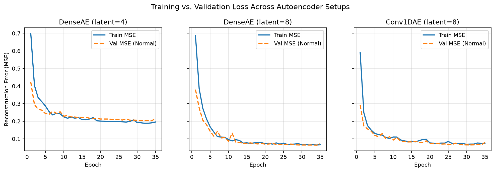
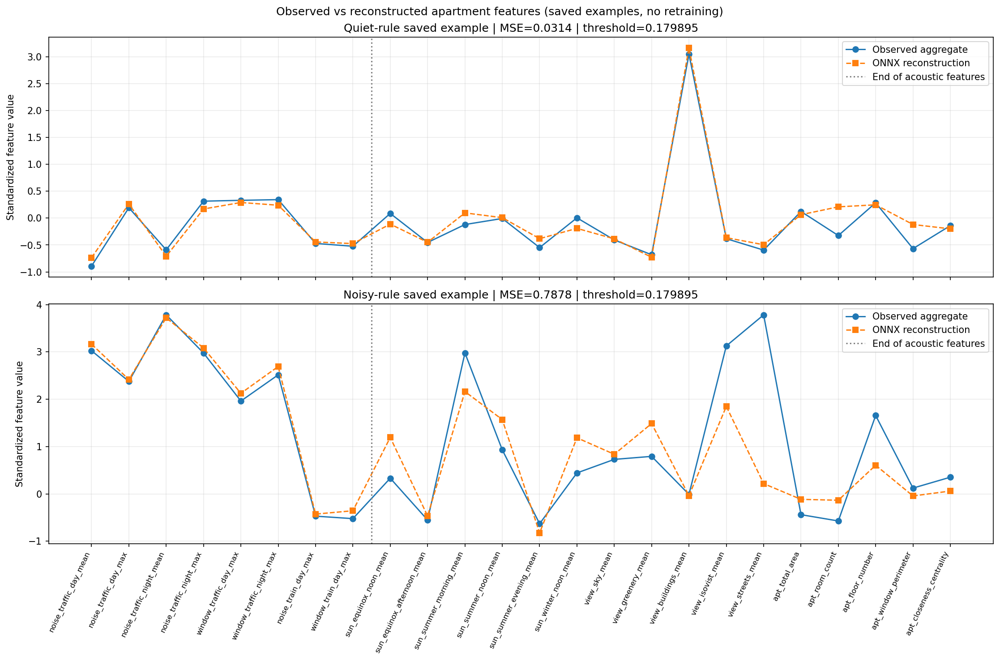
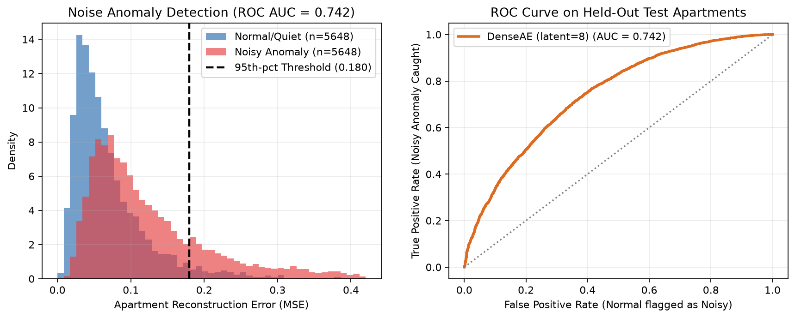
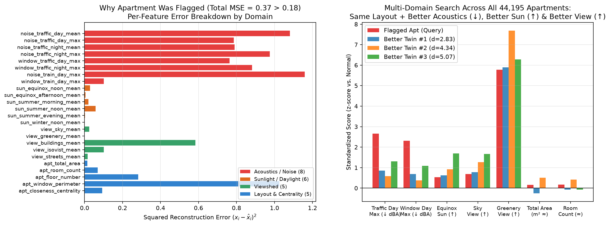

# Swiss Dwellings: autoencoder anomaly detector and Quiet Twin Finder

Team 5 project for **AI Methods I, IAAC MaAI 2026/27**.
The model scores apartment-level environmental/layout features and produces an eight-number apartment fingerprint.
Homebuyers and real-estate analysts can inspect unusual profiles and explore potentially quieter alternatives.

**Team:** Breno Sader, Diego Alpizar, Sindhuja Davuluri, Soumyajyoti Datta.

**Code:** [https://github.com/iaac-maai/hackathon-team5-swiss-dwellings](https://github.com/iaac-maai/hackathon-team5-swiss-dwellings)
**Model:** [Hugging Face repository](https://huggingface.co/iaac-maai/hackathon-team5-swiss-dwellings)
**Notebook:** [01_autoencoder/notebook/autoencoder.ipynb](https://github.com/iaac-maai/hackathon-team5-swiss-dwellings/blob/main/01_autoencoder/notebook/autoencoder.ipynb)

## Updates to model: 17 November 2026

- The selected model remains **DenseAE-8** with **24 input features**, threshold **0.179895**, and recorded test ROC AUC **0.7418**.
- Twin search now covers the full **44,195-apartment catalog**, with selectable acoustic, sunlight and view improvements, rather than only the compact 300-apartment reference.
- The latest saved comparison updates training times and Conv1DAE metrics; the table below reflects those outputs.
- All exports are kept in `01_autoencoder/model_app/`; the notebook no longer creates a duplicate `models/` folder.
- Current ONNX SHA-256: `884fb2b59c052b72862f0b07e9ef1b3c983c2d9e60494ae4738d35d2c24e77e3`.

## The autoencoder

| | |
|---|---|
| **Type** | Dense tabular autoencoder. Encoder: 24 -> 64 -> 32 -> 8; decoder: 8 -> 32 -> 64 -> 24; ReLU between hidden layers, linear decoder output. |
| **Trained on** | Swiss Dwellings v3.0.0: 26,248 rule-normal residential apartments; 24 features across acoustics, sun, views and layout. |
| **Use** | Reconstruction-error anomaly detection; experimental similarity search using the 8-dimensional latent vector. |
| **Score** | Mean squared error between the standardized input and reconstruction, averaged across all 24 features. |
| **Threshold** | **0.179895**, the 95th percentile of normal validation error, stored in `anomaly_ae_config.json`. |
| **Test result** | Noise-rule ROC AUC **0.7418**, precision **0.8138**, recall **0.2144**, on a balanced test set. These are preliminary proxy-label metrics; see limitations. |
| **Format** | `anomaly_ae.onnx`, 48,788 bytes, run with CPU ONNX Runtime; PyTorch is unnecessary for inference. |
| **Notebook** | Linked above; saved outputs record the training comparison and five-sample PyTorch/ONNX score agreement. |

**Input:** 24 finite **apartment-level aggregates**, ordered exactly as `config["feature_names"]`.
Apply `(raw - scaler_mean) / scaler_scale` using the exported configuration. The scaler was fitted on normal
training apartments only. Raw room CSV rows cannot be passed directly to this model. Reject missing or nonfinite values;
do not fit a replacement scaler. Stored scaler vectors and example features were rounded by the exporter.

**Output:** ONNX returns `reconstruction` with shape `(batch, 24)` and `latent` with shape `(batch, 8)`.
Application code computes `score`, `threshold`, `is_anomaly`, `score / threshold` and per-feature squared errors.
An error contribution is not a causal explanation or a probability of a defect.

## Dataset

**Swiss Dwellings v3.0.0**, Matthias Standfest et al. / Archilyse AG.
[Source: Zenodo 7788422](https://zenodo.org/records/7788422), DOI **10.5281/zenodo.7788422**.

The published dataset describes 45,176 apartments and approximately 370,000 rooms, distributed in an approximately
932 MB ZIP. The saved run read **367,678 room/area records** from `simulations.csv` (reported as 1,521 MB) and retained
**44,195 apartments** with at least two area records and complete aggregated features.
Grouping keys are `(site_id, building_id, apartment_id)` after residential filtering.

| Feature group | Apartment-level features |
|---|---|
| Acoustics: 8 | Traffic day/night means and maxima, window traffic day/night maxima, daytime train and window-train maxima |
| Sun: 6 | Mean sun simulation values at equinox noon/afternoon, summer morning/noon/evening, winter noon (not direct daylight-factor measurements) |
| Views: 5 | Sky, greenery, buildings, isovist and combined street views |
| Layout/centrality: 5 | Summed area, area-record count, mean floor number, summed window perimeter, mean closeness centrality |

Noise means are arithmetic summaries of dBA, not energy-equivalent acoustic averages. `apt_room_count` counts area records
(including ancillary spaces); summed `layout_area` is not independently verified net living area.
Training requires the original simulations; inference needs only this model, its configuration and user feature values.
The current training notebook reads a local CSV rather than streaming directly from Zenodo.

## Training setup and comparison

All setups used seed 42, 35 epochs, batch size 256, Adam at 0.001 and MSE loss on the same normal training/validation split.
Normal validation contains **5,666 apartments**. Evaluation contains **5,648 normals plus 5,648 noisy-rule apartments**.
Each model uses its own normal-validation 95th-percentile reconstruction threshold.

The labels are **noise-rule proxies**, not independently annotated ground truth: indoor daytime traffic above the
full-dataset 90th percentile, window daytime traffic above the 92nd, or indoor daytime train noise above the 95th.
Their union flags **6,633 apartments (15%)**. These percentile rules are not Swiss regulatory limits.

Values below come from the latest saved notebook outputs; preparing this card does not retrain the model.

| Setup | Latent | Params | Train time (s) | Val MSE (normal) | Test MSE (normal) | Threshold | Test ROC AUC | Precision | Recall |
|---|---:|---:|---:|---:|---:|---:|---:|---:|---:|
| DenseAE-4 | 4 | 7,644 | 23.22 | 0.2174 | 0.2041 | 0.6154 | 0.7310 | 0.7797 | 0.1209 |
| **DenseAE-8 (selected)** | **8** | **7,904** | **22.65** | **0.0720** | **0.0716** | **0.1799** | **0.7418** | **0.8138** | **0.2144** |
| Conv1DAE-8 | 8 | 7,033 | 39.92 | 0.0718 | 0.0737 | 0.1800 | 0.6906 | 0.7726 | 0.1894 |

DenseAE-8 has the highest reported noise-rule ROC AUC and slightly lower normal test MSE than Conv1DAE-8 in this run. Conv1DAE-8 has the slightly lower normal validation MSE (0.0718 versus 0.0720).
Its validation MSE falls from 0.2174 to 0.0720 compared with DenseAE-4, and its recorded training time is shorter than Conv1DAE-8. Training times depend on the machine; these are the latest saved run, not a speed guarantee.
However, recall is only 0.2144 at the chosen threshold, so it misses many rule-noisy apartments despite precision of 0.8138.
These results support a small experimental model, with leakage and independent validation still unresolved.

## Results and figures

### Training and normal-validation reconstruction loss



Compare validation with training loss to assess convergence and the gap between them. The numerical comparison above
reports held-out normal error separately from noisy-rule detection performance.

### Observed features and model reconstructions



This retained figure comes from an earlier export and was not regenerated with the latest run. It illustrates observed and reconstructed standardized values; use the current exported model and saved examples for current scores. The first eight positions are acoustic features; mismatches elsewhere can also drive an anomaly score.

### Noise-rule anomaly scores and ROC



AUC describes ranking across thresholds; the selected decision threshold still has low recall, as shown in the table.

### Error contributions and similarity demonstration



The latest notebook encodes all **44,195 apartments** into eight-dimensional fingerprints and ranks candidates by Euclidean distance to an edited target fingerprint. Search spans the full catalog, but candidates must initially have normal noise-rule labels.

| Goal | Edited target in standardized units | Candidate filter in original measurements |
|---|---|---|
| Comparable layout | Keep the query's layout inputs | Area within +/-25%; area-record count within +/-2 |
| Improve acoustics | Set the eight acoustic inputs to -0.5 | Indoor and window daytime traffic maxima each more than 10 dBA lower than the query |
| Improve sunlight | Raise each of the six sun inputs to at least +0.8 | Higher equinox-noon sun value |
| Improve view | Raise sky, greenery and isovist inputs to at least +0.8 | Higher sky view and equal or higher greenery view |

The notebook exposes `improve_acoustics`, `improve_sunlight`, `improve_view` and `top_k` (default 3). These are edits to interpretable input features before encoding; latent dimensions are not independently identified noise or daylight controls.

**Notebook fallback:** when fewer than `top_k` candidates pass, `find_better_twins` discards the filters and searches all rule-normal apartments. Returned results can therefore fail the requested improvements or layout tolerance, and even the query exclusion is lost in that fallback. The plot title's "same layout" means approximate area/count matching when the filters remain active, not an identical floor plan.

**Day 2 server behavior:** `02_model_server/app.py` keeps all requested filters and returns fewer matches when necessary, excludes the query, and recomputes fingerprints with its loaded ONNX. These are application changes; the network and anomaly threshold are unchanged.

The saved demonstration query is `2e4d7e256fa899bb4acc18722bceb95f`. Its three shown candidates have indoor daytime traffic maxima approximately **49.97**, **47.06**, and **54.66 dBA**, compared with **69.09 dBA** for the query. This is an illustrative retrieval result, not an independent retrieval benchmark.

`full_apartments_catalog.npz` stores IDs, rule labels, the `(44195, 24)` feature matrix and `(44195, 8)` fingerprints. It is **5,340,741 bytes** (about 5.09 MiB). The older 300-apartment JSON catalog is retained as a compact companion; it no longer defines the full search pool. Similarity needs a derived reference catalog even though scoring a new apartment does not need the original CSV.

## Run it locally

Download the model, configuration and an example using the short script below. Install the pinned inference dependencies:

```bash
python -m pip install -r requirements.txt
```

The published `requirements.txt` is for **inference**, with NumPy, ONNX Runtime and huggingface_hub.
Training dependencies remain in `01_autoencoder/requirements.txt` in the code repository.
The ONNX graph is small enough for CPU use. Original CSVs, the full ZIP, scikit-learn and PyTorch are unnecessary
for scoring a new apartment. A valid 24-feature input is still required.

## Call it from a program

This is direct model inference. Run from the repository root or from `01_autoencoder/model_app/` to use local exports. If local files are absent, the example fetches them from Hugging Face and checks that the model matches this card's export. The checksum check rejects a different export rather than silently using it with this card's instructions. The Day 2 API caller is documented separately in `02_model_server/`.

```python
import hashlib
import json
from pathlib import Path
import numpy as np
import onnxruntime as ort
from huggingface_hub import hf_hub_download

repo_id = "iaac-maai/hackathon-team5-swiss-dwellings"
local_dir = Path("01_autoencoder/model_app")
if not local_dir.is_dir():
    local_dir = Path(".")
# Use one complete local bundle or one remote bundle; do not mix their files.
use_local = (local_dir / "anomaly_ae.onnx").is_file()
def artifact(name):
    return local_dir / name if use_local else Path(hf_hub_download(repo_id, name))
model_path = artifact("anomaly_ae.onnx")
config_path = artifact("anomaly_ae_config.json")
example_path = artifact("examples/quiet_apartment_1.json")
expected_sha256 = "884fb2b59c052b72862f0b07e9ef1b3c983c2d9e60494ae4738d35d2c24e77e3"
if hashlib.sha256(model_path.read_bytes()).hexdigest() != expected_sha256:
    raise ValueError("This model differs from the latest local export documented by this card.")
with open(config_path, encoding="utf-8") as f:
    config = json.load(f)
with open(example_path, encoding="utf-8") as f:
    apartment = json.load(f)

raw = np.array([[apartment["features"][name] for name in config["feature_names"]]], dtype=np.float64)
mean = np.array(config["scaler_mean"], dtype=np.float64)
scale = np.array(config["scaler_scale"], dtype=np.float64)
if not np.isfinite(raw).all() or not np.isfinite(mean).all() or not np.isfinite(scale).all() or (scale <= 0).any():
    raise ValueError("All features and scaler values must be finite, and scales positive.")
x = ((raw - mean) / scale).astype(np.float32)
session = ort.InferenceSession(model_path, providers=["CPUExecutionProvider"])
reconstruction, latent = session.run(["reconstruction", "latent"], {session.get_inputs()[0].name: x})
feature_error = (x - reconstruction)**2
score = feature_error.mean(axis=1)
threshold = config["threshold"]
print({"score": score.tolist(), "threshold": threshold,
       "is_anomaly": (score > threshold).tolist(),
       "score_multiple": (score / threshold).tolist(), "latent": latent.tolist()})
```

## Files

| File | Contents |
|---|---|
| `README.md` | This model card |
| `anomaly_ae.onnx` | Architecture and weights; reconstruction and latent outputs |
| `anomaly_ae_config.json` | Ordered input features, stored scaler arrays, threshold, latent size and recorded AUC |
| `examples/` | Four apartment-level JSON inputs, retaining CC BY 4.0 attribution |
| `requirements.txt` | Pinned inference dependencies |
| `anomaly_ae.pt` | Local PyTorch state dictionary for the selected model |
| `full_apartments_catalog.npz` | Full 44,195-apartment feature/reference catalog and fingerprints |
| `quiet_twins_catalog.json` | Compact 300-normal-test-apartment reference retained from the earlier search |
| `fig1_training_curves.png` | Three-model training/validation curves |
| `fig4_reconstructions.png` | Observed/reconstructed saved-example feature profiles |
| `fig2_anomaly_histogram_roc.png` | Noise-rule score histogram and ROC |
| `fig3_feature_breakdown_and_quiet_twins.png` | Error contributions and experimental candidate comparison |

This release includes the model, configuration, examples, reference catalogs, figures and inference requirements listed above; they are also kept together in the local `model_app/` folder. Scoring uses ONNX and config; retrieval also needs a reference catalog. No original CSV or ZIP is needed at inference time. The NPZ contains derived apartment measurements, not just model weights; retain dataset attribution when sharing it. Its object-array identifiers require pickle-enabled loading, so load only the trusted team-produced artifact, never an uploaded/untrusted NPZ.

## Limitations

1. **Evaluation leakage remains unresolved.** Normal apartments are split by building, but anomalies are sampled
   separately from all noisy apartments, so evaluation anomalies can share buildings with training/validation normals.
   Label cutoffs use the full dataset. The reported scores are preliminary, not a fully building-independent evaluation.
   Split all buildings before calibrating labels in a future experiment.
2. **Proxy labels and prevalence.** Noise is both an input and the basis of the label rule; AUC is not independent
   real-world anomaly accuracy. Precision on a 50/50 balanced evaluation set does not establish deployment precision.
3. **Missed noisy apartments.** Recall is 0.2144. A low score does not certify a quiet apartment, and a high score
   can result from unusual geometry or views. The 95th-percentile rule targets roughly 5% of validation normals;
   it does not guarantee a 5% false-positive rate on new buildings.
4. **Aggregation and similarity.** Room roles/spatial arrangement are lost. The full reference pool includes training,
   validation and test apartments, so this demonstration is not an independent retrieval evaluation. The notebook's
   fallback can discard its filters. Even with filters enforced by the Day 2 server, area/count similarity is not an
   identical plan; acoustic improvement checks daytime traffic, not every noise metric. There is no evidence about
   available listings, price, perceived comfort or measured daylight improvement.
5. **Reproducibility and bundle consistency.** Seed 42 does not guarantee identical runs across hardware/software or
   cell execution orders. Models are initialized before the training function resets its seed. Keep weights, scaler,
   threshold, feature order and fingerprints matched; recompute fingerprints when the model changes.
6. **Export precision.** Stored scaler arrays/examples are rounded. Saved notebook outputs show five-sample
   PyTorch/ONNX score agreement, not coverage of every possible input. Validate missing values and schema at serving time.

## AI disclosure

Antigravity, and OpenAI Codex assisted with code and documentation to follow the class example and submission guidelines. The root GitHub README contains the project-wide AI disclosure; the team owns its
interpretation and final submission.
