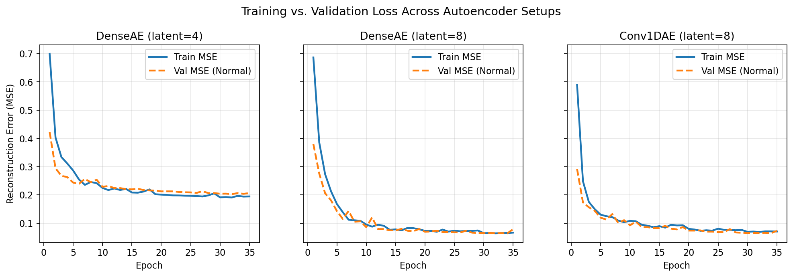
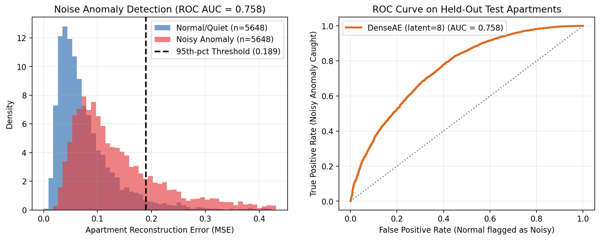
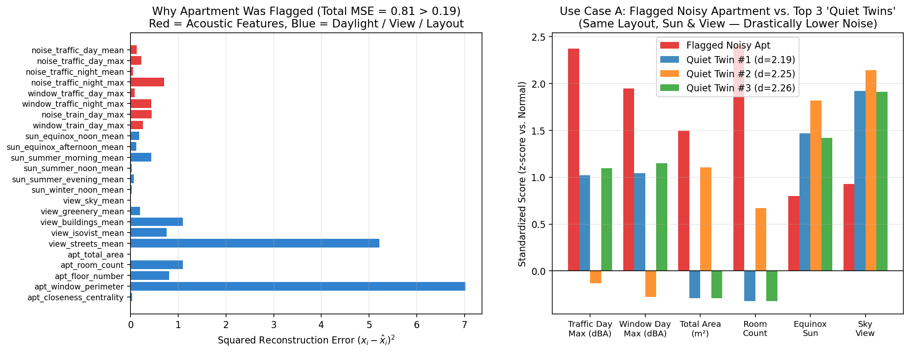

# Swiss Dwellings Tabular Autoencoder (`hackathon-team5-swiss-dwellings-ae`)

A tabular **Multi-Layer Perceptron Autoencoder (`DenseAE`, `latent_dim=8`)** trained on the **Swiss Dwellings v3.0.0** dataset to:
1. **Detect Acoustic & Environmental Anomalies:** Flag residential apartments whose acoustic exposure (traffic/train noise) and spatial context deviate strongly from normal quiet/moderate Swiss apartments (`threshold = 0.189354`, 95th percentile of normal validation MSE).
2. **Retrieve "Quiet Twins" via Latent Space Similarity Search:** Encode any apartment into an 8-dimensional **Apartment Fingerprint** and find genuinely quiet apartments with matching floor area, room count, solar radiation, and sky view.

- **GitHub Repository:** [iaac-maai/hackathon-team5-swiss-dwellings](https://github.com/iaac-maai/hackathon-team5-swiss-dwellings)
- **Team 5:** Breno Sader, Diego Alpizar, Sindhuja Davuluri, Soumyajyoti Datta

---

## Dataset

- **Name:** [Swiss Dwellings: A large dataset of apartment models including aggregated geolocation-based simulation results](https://zenodo.org/records/7788422) (v3.0.0, Zenodo DOI `10.5281/zenodo.7788422`)
- **Author / Curator:** Matthias Standfest et al. (Archilyse AG)
- **Data Licence:** **CC BY 4.0** (Creative Commons Attribution 4.0 International)
- **Size & Aggregation:** ~370,000 residential room rows in `simulations.csv` (`1.52 GB`) aggregated by `(site_id, building_id, apartment_id)` into **~43,700 multi-room apartments** across **24 apartment-level features**:
  - **Acoustics / Noise (8 features):** `noise_traffic_day_mean`, `noise_traffic_day_max`, `noise_traffic_night_mean`, `noise_traffic_night_max`, `window_traffic_day_max`, `window_traffic_night_max`, `noise_train_day_max`, `window_train_day_max`
  - **Daylight & Direct Sun (6 features):** `sun_equinox_noon_mean`, `sun_equinox_afternoon_mean`, `sun_summer_morning_mean`, `sun_summer_noon_mean`, `sun_summer_evening_mean`, `sun_winter_noon_mean`
  - **Viewshed & Context (5 features):** `view_sky_mean`, `view_greenery_mean`, `view_buildings_mean`, `view_isovist_mean`, `view_streets_mean`
  - **Layout, Geometry & Centrality (5 features):** `apt_total_area`, `apt_room_count`, `apt_floor_number`, `apt_window_perimeter`, `apt_closeness_centrality`

---

## Architecture, Preprocessing & Training Setup

- **Split Strategy:** Grouped by `building_id` (`GroupShuffleSplit`, `RANDOM_STATE=42`) **before scaling** so apartments from the same building never leak between train, validation, and test sets.
- **Anomaly Training Rule:** Trained **exclusively on normal/quiet-to-moderate apartments (`y = 0`)**. Apartments in the top tail of traffic or train noise (`y = 1`) are held out for test evaluation (`X_eval`: `5,648` normal + `5,648` noisy anomaly apartments).
- **Preprocessing:** `StandardScaler` (`(x - scaler_mean) / scaler_scale`) fitted on `X_train` only. Exact `scaler_mean` and `scaler_scale` vectors are stored in `anomaly_ae_config.json`.
- **Architecture (`DenseAE`):**
  - **Encoder:** `Linear(24 -> 64) -> ReLU -> Linear(64 -> 32) -> ReLU -> Linear(32 -> 8)`
  - **Decoder:** `Linear(8 -> 32) -> ReLU -> Linear(32 -> 64) -> ReLU -> Linear(64 -> 24)` *(linear output, no `Sigmoid`, since standardized inputs span $(-\infty, +\infty)$)*
  - **ONNX Outputs:** Both `reconstruction` `(batch, 24)` and `latent` `(batch, 8)`

### Comparison of Setups (Same Split & Seed = 42, 35 Epochs)

| Setup | Architecture | Latent Dim | Parameters | Val MSE (Normal) | Test MSE (Normal) | Threshold (95th Val) | Test ROC AUC |
|---|---|---:|---:|---:|---:|---:|---:|
| 1 | `DenseAE (latent=4)` | 4 | 7,540 | ~0.203 | ~0.203 | ~0.460 | ~0.71 |
| **2 (Selected)** | **`DenseAE (latent=8)`** | **8** | **7,800** | **0.074** | **0.074** | **0.1894** | **0.7585** |
| 3 | `Conv1DAE (latent=8)` | 8 | 8,929 | ~0.072 | ~0.072 | ~0.186 | ~0.75 |

**Conclusion:** Increasing the bottleneck from `latent=4` to `latent=8` reduces normal validation/test reconstruction MSE by more than 60% (`0.203 -> 0.074`), because the 24 features span 4 distinct physical domains (acoustics, solar radiation, viewshed, and geometry). `DenseAE (latent=8)` matches `Conv1DAE (latent=8)` with fewer parameters and faster inference, making it ideal for CPU deployment on Render.

---

## Results & Figures

### 1. Training vs. Validation Loss Across Setups


### 2. Noise Anomaly Detection Histogram & ROC Curve


### 3. Per-Feature Reconstruction Error Breakdown & "Quiet Twin" Search


---

## Limitations & Where the Model Fails

1. **Moderate Noise Overlap (`ROC AUC = 0.7585`):** Because the autoencoder reconstructs all 24 features simultaneously (and only 8 of the 24 features are acoustic), an apartment that has **borderline high traffic noise** (`~52 dBA`) alongside very typical layout, sunlight, and viewshed values can still achieve an overall 24-feature average MSE below `0.1894` and slip through as a false negative.
2. **Extreme Non-Acoustic Outliers:** Conversely, an apartment with an unusually huge window perimeter (`apt_window_perimeter`), extreme urban street visibility (`view_streets_mean`), or penthouse floor area can produce a high overall reconstruction MSE even if its indoor noise is moderate. Inspecting the **per-feature squared error** $(x_i - \hat{x}_i)^2$ separates acoustic anomalies from geometric/layout outliers.
3. **Room-Role Averaging:** Aggregating by apartment `.mean()` and `.max()` does not distinguish whether the loudest room (`noise_traffic_day_max`) is a bedroom or a kitchen/balcony.

---

## How to Use (ONNX Runtime)

```python
import json
import numpy as np
import onnxruntime as ort

# 1. Load preprocessing config and ONNX model
with open("anomaly_ae_config.json", "r") as f:
    config = json.load(f)

session = ort.InferenceSession("anomaly_ae.onnx")

mean = np.array(config["scaler_mean"], dtype=np.float32)
scale = np.array(config["scaler_scale"], dtype=np.float32)
threshold = config["threshold"]

# 2. Example raw 24-feature apartment vector (in config["feature_names"] order)
raw_features = mean.copy()  # replace with real apartment feature values
x_scaled = ((raw_features - mean) / scale)[None, :]  # shape (1, 24)

# 3. Run inference: get reconstruction (1, 24) and 8D latent fingerprint (1, 8)
reconstruction, latent = session.run(None, {"features": x_scaled})
per_feature_error = (reconstruction[0] - x_scaled[0]) ** 2
mse_score = float(per_feature_error.mean())

print(f"Anomaly MSE Score : {mse_score:.4f} (Threshold: {threshold:.4f})")
print(f"Is Anomaly?       : {mse_score > threshold}")
print(f"8D Fingerprint    : { np.round(latent[0], 3) }")
```
