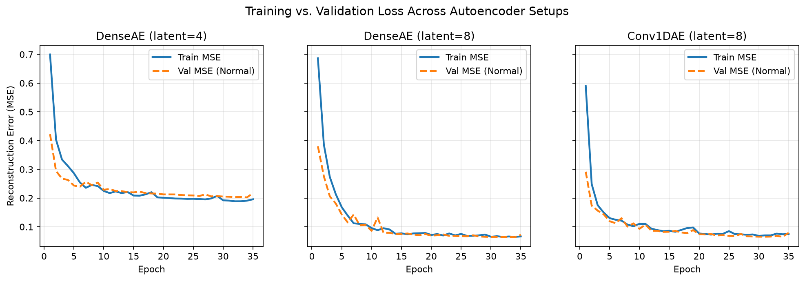
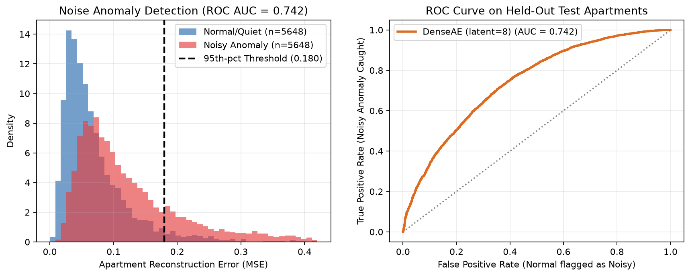
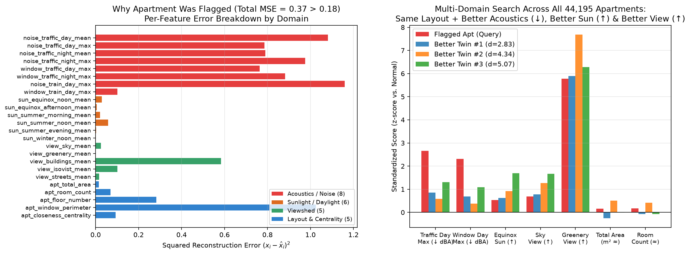

# Day 1: Swiss Dwellings Autoencoder

**Team 5:** Breno Sader, Diego Alpizar, Sindhuja Davuluri, Soumyajyoti Datta.

Train an autoencoder to flag unusual apartment profiles and search the full **44,195-apartment catalog** for alternatives with comparable area/count and selected improvements in acoustics, sunlight and views.

## Dataset

- **Source:** [Swiss Dwellings v3.0.0, Zenodo](https://zenodo.org/records/7788422), Matthias Standfest et al. / Archilyse AG. DOI: `10.5281/zenodo.7788422`.
- **Licence:** CC BY 4.0
- **Size:** approximately 932 MB ZIP; the saved run loaded 367,678 room/area records and retained 44,195 apartments.
- **Input:** 24 apartment-level features: acoustics (8), sun/daylight (6), views (5), and layout/centrality (5).
- **Local file:** `01_autoencoder/data/simulations.csv`. Training reads the local CSV; it does not stream from Zenodo.

Residential room/area records are grouped by `(site_id, building_id, apartment_id)`. Apartments with fewer than two
area records or missing aggregated features are removed. Area-record count is not an official habitable-room count.

## Setup

From `01_autoencoder/`, install the pinned training dependencies:

```bash
python -m pip install -r requirements.txt
```

Open [notebook/autoencoder.ipynb](notebook/autoencoder.ipynb), select that Python environment and run the cells in order.
Relative paths support the repository root, `01_autoencoder/`, and its `notebook/` folder.

All three setups use the same normal-apartment split and seed **42**, **35 epochs**, batch size **256**,
**Adam (learning rate 0.001)** and **MSE loss**. StandardScaler is fitted only on normal training apartments.
Each model's anomaly threshold is its normal-validation reconstruction error's 95th percentile.
Noise labels are percentile-rule proxies, not independently annotated ground truth.

The selected **DenseAE-8** uses an encoder `24 -> 64 -> 32 -> 8` and mirrored decoder, with ReLU hidden layers and
linear output. It returns a reconstruction and an eight-dimensional apartment fingerprint.
Exported ONNX weights, preprocessing configuration and examples are in `model_app/`; inference needs no original CSV
or PyTorch. Similarity search additionally needs `model_app/full_apartments_catalog.npz`, containing apartment IDs,
noise-rule labels, 24 raw features and 8-dimensional fingerprints for all 44,195 apartments (about 5.09 MiB).
The older 300-apartment `quiet_twins_catalog.json` is retained as a compact companion.
All exports stay in `model_app/`; the notebook no longer creates a duplicate `models/` folder.

The latest notebook's `find_better_twins` first filters normal-rule candidates to area within +/-25% and area-record count
within +/-2. Optional goals require indoor/window daytime traffic maxima each more than 10 dBA lower, higher equinox-noon
sun values, and better sky/greenery views. It ranks candidates by distance to an edited target fingerprint.
If fewer than the requested matches pass, the notebook falls back to all normal-rule apartments and drops these filters;
results therefore need review. The Day 2 server preserves the filters and returns fewer matches instead.

## Results

Latest saved notebook results (reviewed 17 November 2026; no retraining for this documentation update):

| Setup | Latent | Parameters | Train time (s) | Val MSE (normal) | Test MSE (normal) | ROC AUC | Precision | Recall |
|---|---:|---:|---:|---:|---:|---:|---:|---:|
| DenseAE-4 | 4 | 7,644 | 23.22 | 0.2174 | 0.2041 | 0.7310 | 0.7797 | 0.1209 |
| **DenseAE-8 (selected)** | **8** | **7,904** | **22.65** | **0.0720** | **0.0716** | **0.7418** | **0.8138** | **0.2144** |
| Conv1DAE-8 | 8 | 7,033 | 39.92 | 0.0718 | 0.0737 | 0.6906 | 0.7726 | 0.1894 |

DenseAE-8 achieves the highest reported noise-rule ROC AUC and slightly lower normal test error than Conv1DAE-8.
Conv1DAE-8 has the slightly lower validation MSE (0.0718 versus 0.0720), while DenseAE-8 trains faster in this saved run.
The selected model's threshold remains **0.179895**. Recall is low: a low reconstruction score does not certify quietness.
Training times depend on hardware and cannot be compared as fixed model properties.

**Training and validation loss**



**Anomaly scores and ROC curve**



**Feature errors and full-catalog twin search**



The saved demonstration compares a query with indoor daytime traffic maximum **69.09 dBA** to candidates at approximately
**49.97**, **47.06**, and **54.66 dBA**. These are historical dataset examples, not available listings or a retrieval benchmark.
`fig4_reconstructions.png` is retained from an earlier run and was not regenerated with the latest export.

**Limitations:** evaluation anomalies may share buildings with training normals, and noise-label cutoffs use the full
dataset. Metrics are preliminary and measured on an artificially balanced test set. Room aggregation loses spatial
arrangement; area-record count is not official room count, and the notebook fallback may discard its matching filters.
Even filtered matches do not guarantee identical plans, lower train noise or measured daylight comfort. The full retrieval
catalog includes training and evaluation apartments. See the model card for details.

**Publication status:** the latest model, updated card, matching configuration, examples and reference artifacts were published to the existing Hugging Face repository on 17 November 2026. All 15 release files were verified against local SHA-256 checksums (commit `1f410d690ad7e6e6d46442e856f9232183542973`).

## Links

- [Published model and model card](https://huggingface.co/iaac-maai/hackathon-team5-swiss-dwellings)
- [Model card](model_app/README.md)
- [Training notebook](notebook/autoencoder.ipynb)
- [Pinned training requirements](requirements.txt)
- [Exported preprocessing configuration](model_app/anomaly_ae_config.json)
- [Example inputs](model_app/examples/)
- [Full apartment reference catalog](model_app/full_apartments_catalog.npz)
- [Day 2 model server and API instructions](../02_model_server/readme.md)
- [Additional result figures](figures/)
- [Team GitHub repository](https://github.com/iaac-maai/hackathon-team5-swiss-dwellings)
- [Project overview and AI usage disclosure](../README.md)
