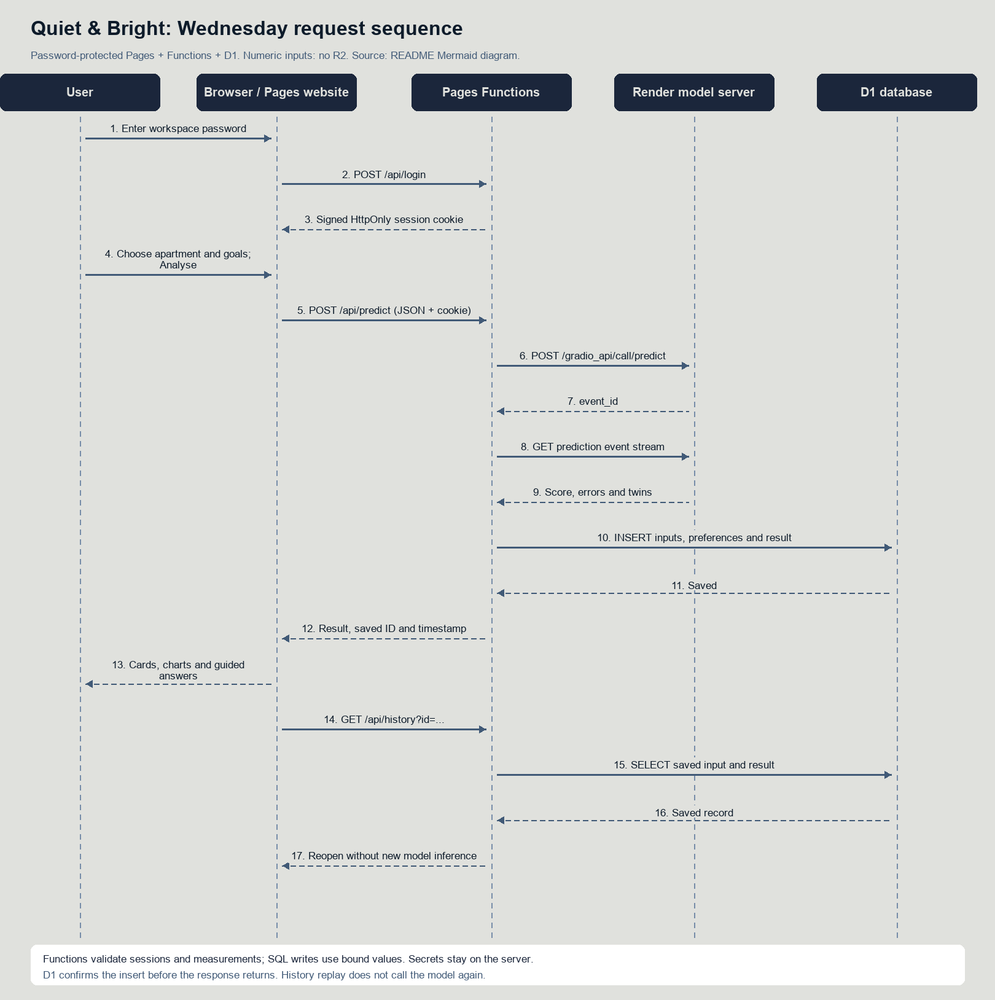

# Day 3: Quiet & Bright Twin Finder on Cloudflare

**Team 5:** Breno Sader, Diego Alpizar, Sindhuja Davuluri, Soumyajyoti Datta.

**Cloudflare app URL:** https://team5-swiss-dwellings.pages.dev

Pages project: `team5-swiss-dwellings`; D1 database: `team5-swiss-dwellings-db` (`99a62e6c-464b-41d4-98b0-69c6978853f8`). Authentication and D1 history were verified online. Live predictions currently return HTTP 503; the Render model connection still needs troubleshooting.

**Existing model server:** https://hackathon-team5-swiss-dwellings.onrender.com

This folder adapts **section 3, Wednesday** of the course `02_deployment.ipynb`. It adds a password-protected Cloudflare Pages website, Pages Functions, a D1 database and prediction history around our existing Render model. It does not retrain or modify the model.

## What users do

1. Log in with the shared workspace password supplied separately by the team.
2. Choose one of four saved apartment examples or enter custom measurements. Select acoustic, sunlight and view goals and request 1-5 matches.
3. Analyse the profile. The page shows the anomaly score/verdict, feature-error bars, actual twin measurements and a comparison table.
4. Use predefined question buttons to understand the current analysis. The helper uses fixed explanations and actual result values; it needs no language-model API.
5. Reopen a saved analysis from history without calling the model again. History is shared by everyone using this workspace password.

The interface follows the requested navy/slate palette (`#0D1B2A`, `#1B263B`, `#415A77`, `#778DA9`, `#E0E1DD`). Analysis chart colors are retained: acoustics `#ce775b`, sun `#d5a549`, views `#469b7e`, layout `#728eab`.

## Files and services

| File | Purpose |
|---|---|
| `wrangler.toml` | Pages project name, Render address, expected model checksum and D1 binding |
| `package.json`, `package-lock.json` | Pinned Wrangler dependency and repeatable development/deployment commands |
| `schema.sql` | D1 predictions table and creation-time index |
| `.dev.vars.example` | Blank local-secret template; the real `.dev.vars` is ignored by Git |
| `public/index.html`, `style.css`, `app.js` | Dashboard, form validation, result rendering, history replay and guided questions |
| `public/data.js` | The 24 feature names/labels and four derived saved examples, attributed to Swiss Dwellings |
| `public/login.html`, `login.js` | Password form; the password is sent to the server, not checked in page code |
| `functions/_middleware.js` | Password gate, signed/expiring cookie validation, request-size helper and response headers |
| `functions/api/login.js`, `logout.js` | Issue or expire the HttpOnly session cookie |
| `functions/api/predict.js` | Validate raw inputs, call Gradio over HTTP, verify the model version and save the result |
| `functions/api/history.js` | List the latest 20 analyses or reopen one complete saved analysis |
| `diagrams/sequence.png` | Required sequence diagram matching the implementation |

**Cloudflare services:** Pages serves the website; Pages Functions check authentication and call Render; D1 stores each successful prediction. **R2 is not used** because this app accepts numeric form inputs, with no file uploads. The submission guidelines require R2 only if uploaded files are used.

## Architecture and sequence



```mermaid
sequenceDiagram
    actor User
    participant Page as Browser / Pages website
    participant Function as Pages Functions
    participant Model as Render model server
    participant DB as D1 database
    User->>Page: Enter workspace password
    Page->>Function: POST /api/login
    Function-->>Page: Signed HttpOnly session cookie
    User->>Page: Choose apartment and goals; Analyse
    Page->>Function: POST /api/predict (JSON + cookie)
    Note over Function: Validate session and input
    Function->>Model: POST /gradio_api/call/predict
    Model-->>Function: event_id
    Function->>Model: GET prediction event stream
    Model-->>Function: Score, errors and twins
    Function->>DB: INSERT inputs, preferences and result
    DB-->>Function: Saved
    Function-->>Page: Result, saved ID and timestamp
    Page-->>User: Cards, charts and guided answers
    Page->>Function: GET /api/history?id=...
    Function->>DB: SELECT saved input and result
    DB-->>Function: Saved record
    Function-->>Page: Reopen without new model inference
```

The browser calls only its own `/api/...` routes. Model calls happen in a Function, using the same two-step Gradio protocol verified on Tuesday. A single 120-second timeout covers the ticket request and streamed result. Model failures produce a visible retry message. A result is returned as successful only after its D1 insert succeeds.

## Prerequisites

Install **Node.js LTS**, which includes npm/npx, from [Node.js](https://nodejs.org/en/download). Then reopen your terminal and check:

```powershell
node --version
npm --version
```

The pinned course-example Wrangler version is **4.156.1**. Use Node 22 or newer. Local development does not require a Cloudflare account. The implementation was checked with a portable Node runtime for verification; that temporary runtime does not install Node on your normal PATH.

## Run locally

From the repository root:

```powershell
cd 03_app
npm ci
Copy-Item .dev.vars.example .dev.vars
```

Only copy the template if `.dev.vars` does not already exist. Open `.dev.vars` in your editor and set `APP_PASSWORD` to a private local password. Leave `MODEL_URL` commented to use Render, or set it to `http://127.0.0.1:7861` while that local Gradio server is running. Never paste a password or token into chat or commit it.

```powershell
npm run db:local
npm run dev
```

Open **http://localhost:8788** and log in. Keep the terminal running; Ctrl+C stops it. `.wrangler/` contains the local database state, so local history persists between local server restarts. It is ignored by Git and is separate from the production D1 database.

The real D1 database ID is already configured in `wrangler.toml`. Local commands still use a separate local database.

If your npm version reports skipped `esbuild` or `workerd` install scripts, first try the commands above. This project's local runtime worked without approving additional scripts. If startup fails, inspect the actual error instead of changing package versions blindly.

## Cloudflare resources and deployment

The Pages project and D1 database listed above have been created, the schema applied, the password stored as a Pages secret, and the site deployed. The commands below are retained as a guide for a **new** Cloudflare account or a replacement deployment; do not recreate the existing resources. Run them inside `03_app/`:

```powershell
npx wrangler login
npx wrangler d1 create team5-swiss-dwellings-db
```

For a new database, copy its returned **database_id** into `wrangler.toml`. Keep `binding = "DB"`. If the chosen names already exist in your account, use the same available names consistently in the config and commands.

```powershell
npm run db:remote
npx wrangler pages project create team5-swiss-dwellings --production-branch main
npx wrangler pages secret put APP_PASSWORD --project-name team5-swiss-dwellings
npm run deploy
```

Enter the production workspace password only at the secret prompt. `wrangler.toml` already points to the actual Render URL, without a trailing slash. Deploy from this folder so Wrangler finds `functions/`, `public/` and the D1 configuration. The Python model and its original CSV are not deployed to Cloudflare.

Wrangler prints a deployment URL. The current project URL is recorded above. Verify login, prediction and history against the production address. Share the password only in the private course hand-in, as required by the submission guidelines. The repository README must not contain the password.

This is a **Pages** project following the course workflow. The provided commands deploy through Wrangler; GitHub integration is optional, and committing code alone does not establish that the Cloudflare app is deployed.

## API and stored data

| Endpoint | Input / output | Login required |
|---|---|---|
| `POST /api/login` | JSON `{ "password": "..." }`; sets a signed one-day cookie | No |
| `POST /api/logout` | Expires the session cookie | Yes |
| `POST /api/predict` | JSON apartment `features`, optional `apartment_id`/`label`, goals and `top_k`; returns saved result | Yes |
| `GET /api/history` | Latest 20 IDs, timestamps, labels, scores, verdicts, model hashes and twin counts | Yes |
| `GET /api/history?id=<id>` | Original request plus full saved model response | Yes |

The prediction body has exactly the same feature names and raw units as Tuesday's `/predict` input. It is ordinary JSON, not base64 or an image upload. The Function sends `{"data": [JSON.stringify(input)]}` to Gradio and decodes the completed event.

Each D1 row stores `id`, `created_at`, `apartment_id`, `label`, the complete `input_json`, `score`, `threshold`, `is_anomaly`, `model_sha256` and the complete `result_json` including twins and feature errors. SQL uses prepared statements with bound values. IDs are random UUIDs. The database stores no login password, session token, original CSV or trained weights.

The expected model SHA-256 is `884fb2b59c052b72862f0b07e9ef1b3c983c2d9e60494ae4738d35d2c24e77e3`. A different model response is rejected so the app cannot silently mix versions. Keep the model server and app checksum synchronized when changing the trained model.

## Local checks and production checklist

**Verified locally on 18 November 2026:** signed/expired/forged sessions, protected pages/assets/APIs, input validation, real ONNX inference through a Pages Function, D1 save/list/replay, predefined questions, stale-result reset, desktop/mobile layout and logout. The example returned score **0.369311**, threshold **0.179895**, and three twins. SQL inserts and replay preserved the exact submitted measurements.

**Live Render check:** the configured public Render readiness endpoint timed out during this verification, and the app's failed model request correctly returned a visible 503 error. The full end-to-end pass therefore used a local Gradio server running the real exported ONNX, via a temporary `.dev.vars` MODEL_URL override. The temporary test password/override were removed afterwards. `wrangler.toml` still points to the correct public Render URL. Check Render's logs/readiness before production verification; the local pass does not establish that the live service is currently healthy.

**Production:** Pages and D1 are deployed and configured. Live login and D1 history passed; the live prediction returned HTTP 503, so check the Render model service and repeat the prediction and history verification.

Before the Day 3 hand-in, verify:

- [x] A public Cloudflare Pages URL is recorded above.
- [x] Page and API access require a valid password session (live login and unauthenticated history checked).
- [ ] The page calls the existing Render model through a Pages Function.
- [ ] Every successful analysis is saved in the production D1 database and can be reopened.
- [ ] The README explains the app, login procedure and Cloudflare services.
- [x] R2 decision is documented: no file uploads, so D1-only storage is appropriate.
- [x] `diagrams/sequence.png` is a real diagram matching the request flow.
- [x] No real `.dev.vars`, tokens or passwords were added to the submission files; runtime/cache directories are ignored by Git.
- [ ] The final reviewed source is pushed to `main` before **Thursday 19 November 2026, 10:00 Europe/Madrid**.

The remaining production items stay unchecked until live predictions and D1 writes succeed. The source files have not been committed or pushed automatically.

## Interpretation and limitations

The model uses 24 aggregates and an eight-dimensional fingerprint; its recorded noise-rule ROC AUC is 0.7418 and threshold 0.179895. Noise labels are percentile proxies. Evaluation anomalies can share buildings with training normals, and label cutoffs use the full dataset. Reconstruction errors explain model mismatches rather than physical causes; a low score does not guarantee quietness. Area-record count is not official habitable-room count. Similarity filters compare approximate size/count and chosen environmental proxies, not identical plans or live listings.

The Render free service sleeps after inactivity and can take about a minute to wake. The page shows a clear loading message and preserves a visible failure message on timeout. Change inputs or preferences to start a fresh analysis; reopening history does not rerun inference.

## Links and AI disclosure

- [Day 2 model server](../02_model_server/readme.md)
- [Model card](../01_autoencoder/model_app/README.md)
- [Hugging Face release](https://huggingface.co/iaac-maai/hackathon-team5-swiss-dwellings/tree/1f410d690ad7e6e6d46442e856f9232183542973)
- [Team code repository](https://github.com/iaac-maai/hackathon_team5_swiss_dwellings)
- [Cloudflare Pages configuration](https://developers.cloudflare.com/pages/functions/wrangler-configuration/)
- [Cloudflare D1 setup](https://developers.cloudflare.com/d1/get-started/)

Codex adapted the supplied course Wednesday workflow to numeric apartment inputs, wrote the source/comments and setup instructions, generated the sequence diagram, and ran local checks. The team supplies the Cloudflare account, real resource IDs and private password, reviews the results, and completes the production verification. The root README contains the project-wide AI-use disclosure.
